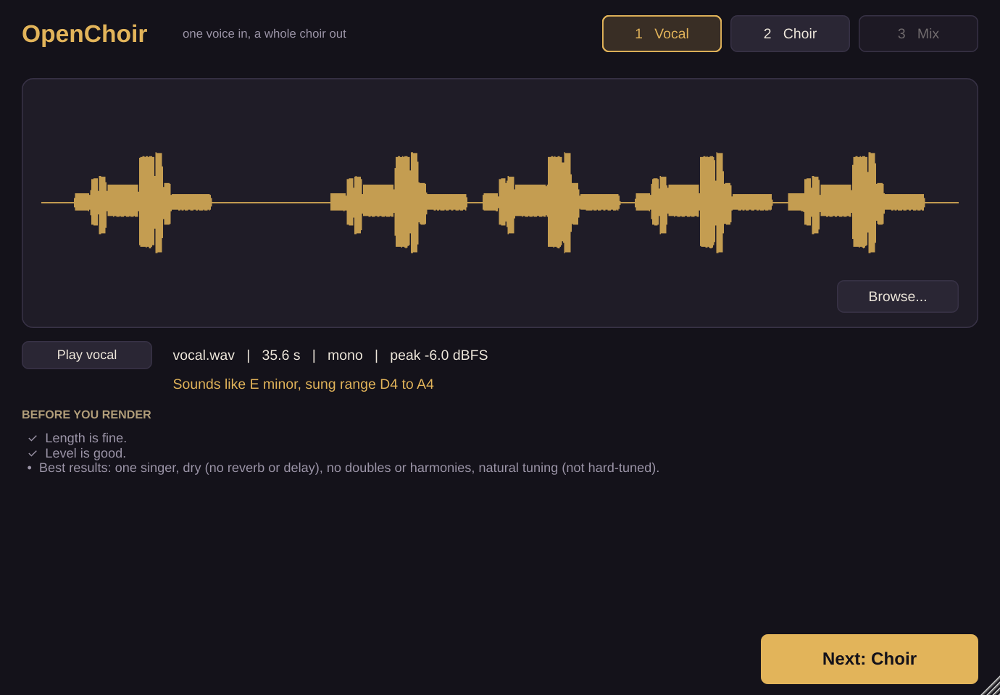
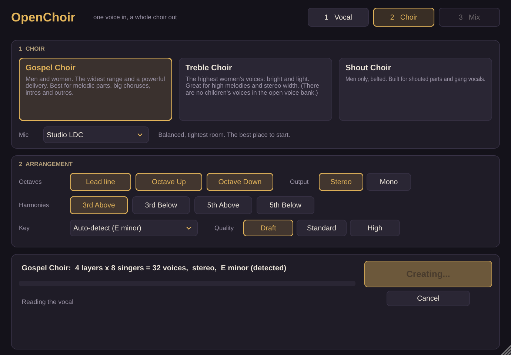
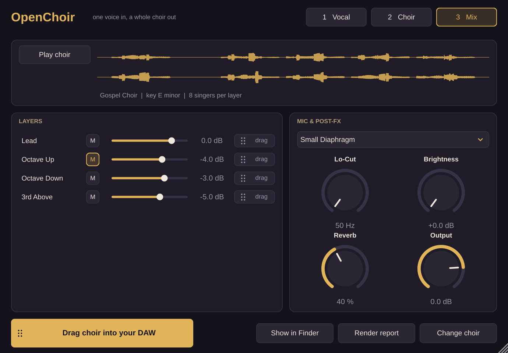
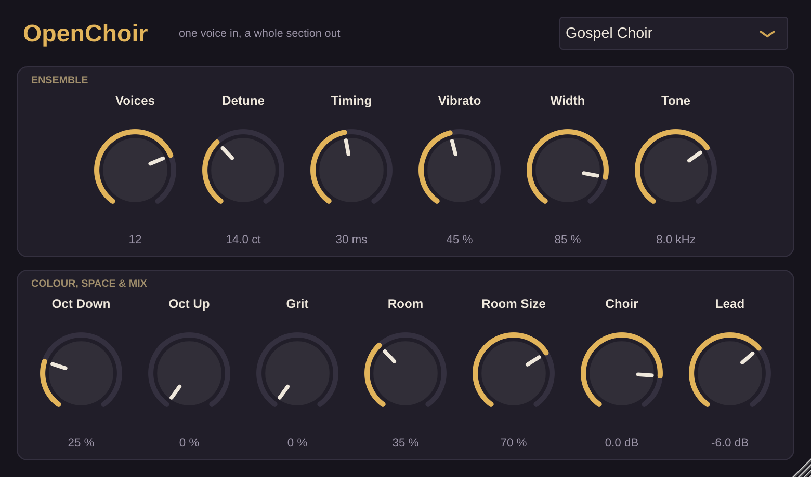

# OpenChoir

**One vocal in, a whole choir out.** OpenChoir is a free, open-source plugin that turns a single lead vocal into a choir or gang vocal, sung by real singers' voices using AI. Everything runs on your own computer.

| 1. Vocal | 2. Choir | 3. Mix |
|---|---|---|
|  |  |  |

## How it works

OpenChoir follows the same workflow as commercial AI choir plugins such as I AM CHOIR. Put it on an **instrument track** and work through its three screens.

### 1. Vocal

Drop in a dry, single-voice lead vocal (WAV, AIFF, FLAC or MP3), or click **Browse**.

The screen then shows:
- the waveform
- the length, channel layout and peak level
- the key it hears, and your sung range

It also lists checks for anything that will hurt the result. The best results come from:
- one singer
- no reverb or delay
- natural tuning, not hard-tuned
- peaks around −12 to −6 dBFS

Click **Play vocal** to hear the take you loaded.

### 2. Choir

Pick a choir:

| Choir | Who sings | Best for |
|---|---|---|
| **Gospel Choir** | men and women | the widest range and a powerful sound; melodies, big choruses, intros and outros |
| **Treble Choir** | the highest women's voices | high melodies, top-end sparkle and width |
| **Shout Choir** | men, belted | shouted parts and gang vocals |

Then choose:
- **Mic**: Studio LDC, Bright LDC, Small Diaphragm or Vintage LDC. Each is a tone-and-room colour. You can also change it later on the Mix screen without re-rendering.
- **Octaves**: Octave Up and Octave Down. Both are recommended for a big sound.
- **Harmonies**: 3rd Above, 3rd Below, 5th Above and 5th Below. Each harmony follows the **Key**, so every note stays in the scale. The key is auto-detected, or you can pick any major or minor key.
- **Output**: Stereo or Mono.
  - A mono vocal becomes a wide stereo choir.
  - A stereo file with separate left and right takes becomes a separate choir on each side.
  - Mono uses the left channel only.
- **Quality**: Draft, Standard or High, which renders 8, 12 or 20 singers per layer.

Click **Create Vocals**. Rendering runs on your computer and nothing is uploaded. A progress bar shows time remaining, and you can cancel at any point.

### 3. Mix

Every layer (Lead, Octave Up and the rest) is a separate track, with:
- **level** and **mute**
- a **drag** handle that drags just that layer into your DAW

The Mic and Post-FX controls are:
- **Lo-Cut**: a high-pass filter from 50 Hz
- **Brightness**: a high shelf at 3 kHz
- **Reverb**: a 1.5 s room, from dry to reverb only
- **Output**: overall level

**Play choir** previews the mix inside the plugin. Grab **Drag choir into your DAW** to drop the finished choir onto a track, with your levels, mutes and effects baked in. **Show in Finder** reveals the same file.

Reopening your project brings back the vocal, the rendered choir and every setting.

## Where the voices come from

The AI singers are **20 professional singers (11 women, 9 men) from [VocalSet](https://doi.org/10.5281/zenodo.1193957)**, recorded for open release under **CC BY 4.0**. You can use them in your music, including commercially, as long as you credit VocalSet. Every render includes a `report.txt` with the credit.

The voice conversion is [Seed-VC](https://github.com/Plachtaa/seed-vc) (GPL-3.0). It runs locally, using Apple Silicon's GPU when it can. See [ai/README.md](ai/README.md) for how the engine works and how to add your own consenting singers.

There are no children's voices, because VocalSet only contains adults. The Treble Choir is the closest option.

## Also included: OpenChoir Ensemble

OpenChoir Ensemble is the original real-time effect, kept as a separate plugin. It needs no AI and adds zero latency. It turns the vocal on its track into a stack of detuned, time-staggered copies of *you*, with presets including Gospel, Big Hall, Gang Shout and Low Monk Chant. It's great for doubles and for live tweaking.



## Install on a Mac

1. Go to **[Releases](https://github.com/jonathan123jrt/OpenChoir/releases/latest)** and download **OpenChoir-macOS.zip**.
2. Unzip it, right-click **install.command** and choose **Open**. If macOS blocks it, go to **System Settings → Privacy & Security**, click **Open Anyway**, then open it again. The installer adds both plugins (VST3 and AU) and the AI engine, then offers to run the one-time AI setup (about 6 GB, 10–30 minutes).
3. In your DAW, put **OpenChoir** on an **instrument track** and open it.

If setup is interrupted, run it again: it picks up where it stopped. To rebuild only the singer voices, run this in Terminal:

```bash
cd ~/Library/Application\ Support/OpenChoir/ai && .venv/bin/python -u fetch_voices.py --force
```

To build it yourself instead, you need Xcode and CMake:

```bash
cmake -B build -G Xcode -DCMAKE_OSX_ARCHITECTURES="arm64;x86_64"
cmake --build build --config Release
```

Notes:
- The builds are ad-hoc signed but not notarised, which is why the installer clears the macOS quarantine flag.
- Logic Pro and GarageBand use the AU version; other DAWs use the VST3.
- If you add an Audio Unit in Logic and it can't start the AI engine, render from the VST3 in another DAW or use `OpenChoir AI.command`. Then drag the files in.

## Quality checks

Every Mac build runs:
- **OpenChoir self-test**: load a vocal → render with a stand-in engine → preview → export → reopen the project at a different sample rate. It also takes screenshots of the three screens.
- **Ensemble self-test**: state save and restore, every preset at three sample rates, and click-free voice changes.
- **pluginval** (strictness 5) and Apple's **auval** on both plugins.

[REVIEW.md](REVIEW.md) lists what has been measured and fixed.

## License

AGPL-3.0-or-later (see `LICENSE`). Built with [JUCE](https://juce.com). OpenChoir is not affiliated with AM I AUDIO or I AM CHOIR.
